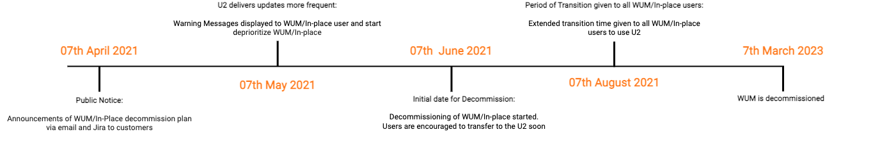

Following is the impending decommission plan for WUM/In-Place tool. WSO2 
recommends all users to shift to the new WSO2 Updates 2.0 model to alleviate from future updates challenges.
 

Listed below is the WSO2 Updates Release plan in detail

| **Dates**             | **Details**                                                                                                                                                                                                                              |
|---------------------- |-----------------------------------------------------------------------------------------------------------------------------------------------------------------------------------------------------------------------------------|
|  **7th April 2021**   | Announcement to all users stating the 'WUM/In-place decommission plan'. Users are able to get updates from WUM/In-place and Updates 2.0. 
|  **7th May    2021 **   | WSO2 Updates 2.0 receive priority to disperse updates over WUM/In-place. Users of Updates 2.0 receive updates sooner. 
|  **7th June  2021**   | Initial decommission date of WUM/In-place. However, this date was extended for user convenience. WUM/In-place users are advised to migrate to Updates 2.0 soon. 
|  **7th August 2021**  | Extended time given to WUM/In-place users to migrate to Updates 2.0, After this day users are able to run the WUM/In-place but there won't be updates given using WUM/In-place. Updates are solely delivered using Updates 2.0. 
|  **7th March 2023**  | WUM/In-place tool is decommissioned completely. 
