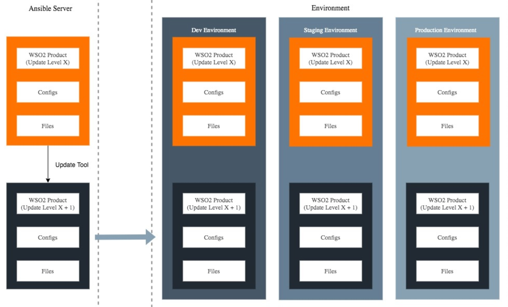

Receiving continuous updates to your environment can be done with ease using WSO2 recommended configuration management tools, which are Puppet and Ansible. 
listed below are the steps:

1. Go to the desired git repository location of the selected configuration management tool.
   [e.g., Let say we are using WSO2 APIM with ansible as the configuration management tool, thus the git repo to refer is `https://github.com/wso2/ansible-apim` ]
2. Clone the correct git repo.
3. Check out the latest tag of the product version.

         git checkout `<version of the latest tag>`

    :::info
    The above command will be like ``git checkout v2.6.0.7`` for the latest WSO2 APIM 2.6.0 version.
    :::
 

4. Store the product pack you've downloaded in the `/files/packs` directory. 

5. Move to the `scripts` directory and run the `update.sh` in the main node.

         cd scripts
         ./update.sh

6.  After the product is updated, propagate the updated product pack to the relevant environments. (i.e. Development, Staging and Production)

  Refer the following diagram for a better understanding on continuous updates:

:::note
For more detailed information on WSO2's Puppet and Ansible configurations, refer the [link](../../faq.mdx).
:::
